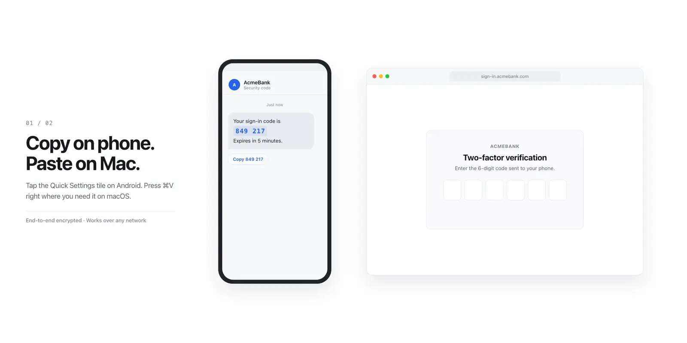

<div align="center">


# clipsync

**Copy on one device, paste on another.**

Sync your clipboard across Mac, Windows, and Android, over any network.<br>
Free, end-to-end encrypted, and no account needed.

[](https://github.com/iyazerski/clipsync/releases/latest)
[](#get-started)
[](LICENSE)
[](https://buymeacoffee.com/iyazerski)

<picture>
  <source media="(prefers-color-scheme: dark)" srcset="docs/demo-dark.webp">
  
</picture>

</div>

## Why clipsync

Apple's Universal Clipboard works only between Apple devices. Phone Link needs a Microsoft account, and its clipboard sync works with only some Android phones. KDE Connect needs your devices on the same network. clipsync works between Mac, Windows, and Android, wherever they are.

- **Mac, Windows, and Android together.** Copy a link on your phone and paste it on your PC. Copy an address on your Mac and paste it on your phone.
- **Works anywhere.** Your devices don't need to be on the same Wi-Fi or near each other.
- **Private by default.** Text is encrypted on your device before it leaves. Nobody else can read it, and passwords from password managers are skipped automatically.
- **No sign-up.** No account, no tracking, and no server to manage. Use the free public relay, or [host your own](#host-your-own-relay).
- **Free and open source.** MIT licensed.

## Get started

Works on **macOS 13+**, **Windows**, and optionally **Android 14+**.

### 1. Install on your computers

Download the installer from the [website](https://iyazerski.github.io/clipsync/), which picks the right file for your computer, or install from the command line:

**Mac** (Homebrew):

```sh
brew install --cask iyazerski/tap/clipsync
```

**Windows** (PowerShell):

```powershell
irm https://github.com/iyazerski/clipsync/releases/latest/download/install.ps1 | iex
```

The app isn't signed by Apple or Microsoft yet, so your computer warns you the first time you open it:

- **Mac** (`.dmg` or Homebrew): Open clipsync once, then go to **System Settings → Privacy & Security** and click **Open Anyway**.
- **Windows** (`.exe`): Click **More info → Run anyway**. The PowerShell command doesn't show this warning because it downloads the installer without a browser. It checks the installer against the release's `SHA256SUMS` before running it.

Every release is built from this repository by GitHub Actions. See [how to check a download](SECURITY.md#check-a-download).

<details>
<summary><b>Windows Defender blocked the install?</b></summary>

New builds don't have reputation with Microsoft Defender yet. If the ransomware protection rule **Use advanced protection against ransomware** is turned on, allow clipsync's folder in an administrator PowerShell, then install again:

```powershell
Add-MpPreference -AttackSurfaceReductionOnlyExclusions "$env:LOCALAPPDATA\Programs\clipsync"
```

On a work PC, ask IT to allow that folder.

</details>

### 2. Pair your devices

1. **First computer:** Open clipsync and click **Set up my first device**.
2. **Other computers:** Click **Add device → Computer** on your first computer. On the other computer, open clipsync, click **Join my other devices**, and type the code.
3. **Android phone:** Click **Add device** on your computer and scan the QR code with your phone's camera. Download and install the app from the page that opens (allow installing from your browser if Android asks), then scan again and tap **Open clipsync**. (No camera? Tap **Enter a code** in the app instead.)

That's it. Copy something on one device and paste it on another.

- **On a Mac:** Click **Allow** if macOS asks whether clipsync can paste.
- **On Android:** Tap **Run in the background** when prompted so sync stays active, and add the **Quick Settings tile**. On ColorOS (OPPO/OnePlus), also turn on **Allow background activity** and **Allow auto launch** under App info → Battery usage.
- **Sending from Android:** Anything you copy on a computer arrives on your phone automatically. Android doesn't let apps read the clipboard in the background, so sending from your phone takes one tap: highlight text and pick **Send to computer**, share text to clipsync, or tap the **Send clipboard** tile in Quick Settings.

## FAQ

<details>
<summary><b>Is my clipboard private?</b></summary>

Yes. Your devices share a private key and encrypt every copy with AES-256-GCM before sending it. The relay passes encrypted data between your devices and can't read it. It only keeps the latest encrypted copy in memory for 2 minutes, and it only sees connection times, IP addresses, and clip sizes.

</details>

<details>
<summary><b>Is it safe to install an app that isn't signed?</b></summary>

The code is open, and every release is built from it by GitHub Actions, not on someone's laptop. You can check that a download came from that build with the [GitHub CLI](https://cli.github.com):

```sh
gh attestation verify clipsync.apk --repo iyazerski/clipsync
```

[SECURITY.md](SECURITY.md#check-a-download) has more ways to check, including the Android app's signing certificate. Free Windows code signing from [SignPath Foundation](https://signpath.org) is in progress, see the [code signing policy](CODE_SIGNING.md).

</details>

<details>
<summary><b>Does it sync images or files?</b></summary>

No. Text only, up to 256 KB. There's no clipboard history, and the latest copy wins.

</details>

<details>
<summary><b>What if a device was offline?</b></summary>

If it reconnects within 2 minutes, it gets the latest copy. After that, it starts fresh so you don't get stale text.

</details>

<details>
<summary><b>Does it work on iPhone or Linux?</b></summary>

Not yet. clipsync currently supports macOS (Apple silicon and Intel), Windows, and Android.

</details>

<details>
<summary><b>How do I change settings or update the app?</b></summary>

Open **Settings** in the desktop app to pick a language, toggle opening at login or showing in the menu bar / notification area, check logs, or manage automatic updates. On Android, open the ⋮ menu and tap **Check for updates**.

</details>

<details>
<summary><b>How do I remove a lost or old device?</b></summary>

On a computer, open **Devices**, click **⋯** next to the device, and choose **Remove…**. That creates a new pairing key so the removed device can't sync anymore. Then unpair your other devices and re-add them with the new code. (If you host a private relay with `CLIPSYNC_TOKEN`, update its token from **Settings** and restart it before clicking **New code**.) **Hide from list** only hides the device from that computer's list.

</details>

<details>
<summary><b>How do I uninstall clipsync?</b></summary>

- **Mac:** Open **Settings → Unpair**, quit clipsync, and drag it from Applications to the Trash (or run `brew uninstall --cask clipsync` if you installed with Homebrew).
- **Windows:** Open **Settings → Unpair**, quit clipsync, and uninstall it from **Settings → Apps**.
- **Android:** Tap **Unpair** in the ⋮ menu and uninstall the app.

</details>

## Host your own relay

By default, clipsync uses the free public relay at `clip.iyazerski.dev`. It can't read your clipboard, but it comes with no uptime guarantee. You can host your own relay on any server with Docker, ports 80 and 443 open, and a domain name pointing to it.

1. On your first computer, open clipsync, click **Use your own relay**, enter your domain (such as `clip.example.com`), and choose **Set up my first device**.
2. Open **Settings** and copy your **Relay token**.
3. On your server, start the relay with Docker Compose:

```sh
curl -fsSLO https://raw.githubusercontent.com/iyazerski/clipsync/main/relay/compose.yaml
printf 'RELAY_DOMAIN=clip.example.com\nCLIPSYNC_TOKEN=<your token>\n' > .env
docker compose up -d
```

This runs the relay behind [Caddy](https://caddyserver.com) with automatic HTTPS and only allows your paired devices. To let anyone use your relay, set `CLIPSYNC_PUBLIC=true` instead of `CLIPSYNC_TOKEN`.

Already paired with the public relay? On each computer, open **Settings → Relay → Change** and enter your new address. On Android, unpair and pair again using **Enter a code** with your relay address.

<details>
<summary><b>Already have a reverse proxy?</b></summary>

Run just the relay container and point your proxy at port 8080:

```sh
docker run -d --restart unless-stopped -p 127.0.0.1:8080:8080 \
  -e CLIPSYNC_TOKEN=<your token> ghcr.io/iyazerski/clipsync/relay
```

Your proxy must serve HTTPS and stream responses without buffering. Caddy and Traefik work out of the box. For nginx, disable `proxy_buffering`. Cloudflare quick tunnels (`trycloudflare.com`) don't work because they buffer streams.

</details>

## Build from source

Requires [Go](https://go.dev/dl/) 1.27.4+ (desktop app built with [MyGo](https://mygo.run)) and, for Android, JDK 21 + Android SDK (`ANDROID_HOME`).

```sh
make dev                                  # run desktop app with reload
make app                                  # build desktop app into desktop/build
make test                                 # run Go and Android checks
cd android && ./gradlew assembleRelease   # build Android APK
```

See [CONTRIBUTING.md](CONTRIBUTING.md) for details and pre-commit hooks (`prek install`).

## License

[MIT](LICENSE) © Ihar Yazerski. Third-party licenses are in [THIRD_PARTY_LICENSES.md](THIRD_PARTY_LICENSES.md). Issues and PRs are welcome ([CONTRIBUTING.md](CONTRIBUTING.md)).

[Privacy policy](PRIVACY.md) · [Code signing policy](CODE_SIGNING.md) · [Security](SECURITY.md)

clipsync isn't affiliated with or endorsed by Apple, Microsoft, or Google. Mac, Windows, and Android are trademarks of their owners.
