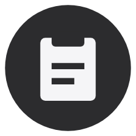
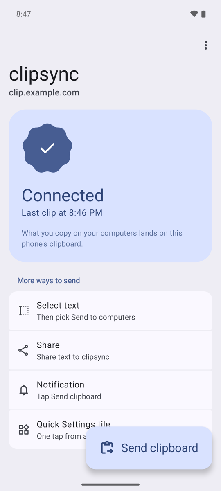
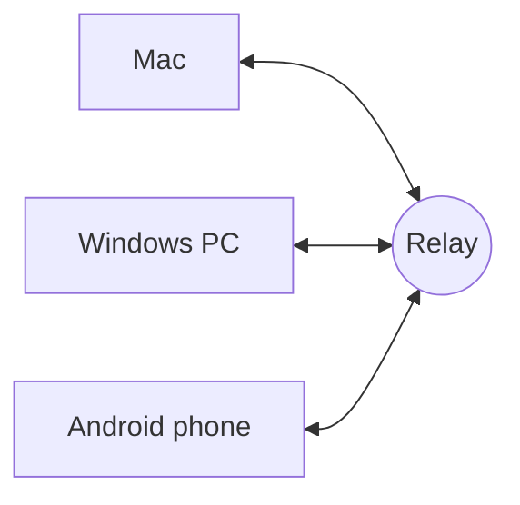
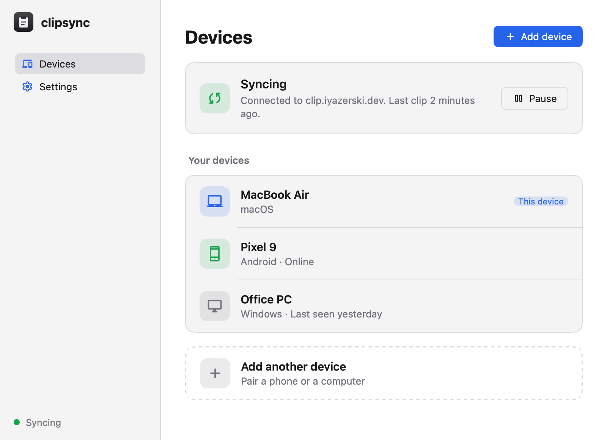

<div align="center">



# clipsync

**Copy on one device, paste on another.**

clipsync keeps the clipboards of your Macs, Windows PCs and Android phone in sync, over any network.<br>
It's end-to-end encrypted, and it runs through a tiny relay: use the public one, or host your own.

[](https://github.com/iyazerski/clipsync/releases/latest)
[](#get-started)
[](LICENSE)
[](https://go.dev)
[](https://buymeacoffee.com/iyazerski)

<picture>
  <source media="(prefers-color-scheme: dark)" srcset="docs/screenshots/phone-dark.png">
  
</picture>

</div>

## Why clipsync

Apple's Universal Clipboard works only between Apple devices that are close to each other. Windows syncs its clipboard only between Windows PCs. Most open-source tools for Android work only on your home Wi-Fi, and stop when the phone saves battery.

- **Mac, Windows and Android together.** Copy a link on your phone and paste it on your work PC. Copy an address on your Mac and paste it into your phone's maps app.
- **Works from anywhere.** Your devices don't need to be on the same Wi-Fi, or near each other. Home, office or mobile data, it keeps working when you switch.
- **Private by design.** Text is encrypted on the device before it leaves. The relay passes it on, but can't read it. It keeps only the latest copy, in memory, for 2 minutes.
- **Skips your passwords.** clipsync ignores copies that password managers mark as private.
- **No account.** No sign-up and no tracking. Use the public relay, or run your own in a small container on an x86-64 or ARM64 host.
- **Set up in minutes.** One small app per computer, and no server or terminal needed. Pair the others with a short code, or the phone by scanning a QR code.
- **Free and open source.** MIT licensed.

## How it works



- **Relay:** a tiny server that passes each copy to your other devices. The public relay at `clip.iyazerski.dev` serves everyone, and keeps each user's devices apart. You can also [host your own](#host-your-own-relay). Nobody is the "host", so it doesn't matter which device is on or what its IP address is.
- **Computers:** the app lives in the menu bar or the notification area. It sends what you copy and puts what your other devices copy on the clipboard. It starts at login.
- **Phone:** the app puts what you copy on your computers on the phone's clipboard, automatically. Android doesn't let apps read the clipboard in the background, so sending from the phone takes one tap: select text and pick **Send to computer**, share text to clipsync, or tap the **Send clipboard** tile in Quick Settings.
- **Encryption:** your devices share one secret. Each copy is sealed with AES-256-GCM on the device. The relay only gets a token derived from the secret, so it can tell which devices belong together, but it can't read what they send. Devices also refuse copies that are old or that they already got.

## Get started

You need:

Macs with macOS 13 or later, Windows PCs, or both. An Android phone with Android 14 or later is optional.

<picture>
  <source media="(prefers-color-scheme: dark)" srcset="docs/screenshots/desktop-dark.png">
  
</picture>

### 1. Install clipsync on your computers

On a Mac, in Terminal:

```sh
curl -fsSL https://github.com/iyazerski/clipsync/releases/latest/download/install.sh | sh
```

On Windows, in PowerShell:

```powershell
irm https://github.com/iyazerski/clipsync/releases/latest/download/install.ps1 | iex
```

Or download the Mac disk image or the Windows setup from the [latest release](https://github.com/iyazerski/clipsync/releases/latest). The apps aren't signed by Apple or Microsoft yet, so the system warns about them the first time. On a Mac, open the app, then go to **System Settings → Privacy & Security** and click **Open Anyway**. On Windows, click **More info → Run anyway**. The commands above skip these warnings.

### 2. Pair your devices

1. On your first computer, open clipsync and choose **Set up my first device**.
2. On each other computer, open clipsync and choose **Join my other devices**. On the first computer, click **Add device** and pick **Computer**. Enter the code that it shows, such as `42 183 059`, on the other computer. A code works once and for 10 minutes.
3. For your phone, click **Add device** and scan the QR code with the phone's camera. The page that opens has the app: download it and install it. Android asks you to allow installing apps from your browser the first time. Then scan again, and tap **Open clipsync**. No camera? Tap **Enter a code** in the app and type the code instead.
4. In the phone app, tap **Run in the background** under **Finish setup**, and **Quick Settings tile** to add it. On ColorOS, also go to App info → Battery usage and turn on **Allow background activity** and **Allow auto launch**.

That's it. Copy something on one device and paste it on another. If macOS asks whether clipsync may paste, click **Allow**.

### Used the clipsync command before?

Install the app as in step 1. It keeps your pairing, and it replaces the old background service. Then remove the command: run `brew uninstall clipsync`, or delete `~/.local/bin/clipsync` on a Mac.

### If Defender blocks clipsync

The Windows binaries aren't signed yet, so a new release has no reputation with Microsoft Defender. If the attack surface reduction rule **Use advanced protection against ransomware** is on, Defender blocks clipsync until enough people run that build. Allow clipsync's folder from an administrator PowerShell, then install again:

```powershell
Add-MpPreference -AttackSurfaceReductionOnlyExclusions "$env:LOCALAPPDATA\Programs\clipsync"
```

On a work PC, IT may manage this rule: ask them to allow that folder.

## Host your own relay

The public relay is a free service with no uptime promise. Host your own if you'd rather nobody else saw when your devices connect, or you want a relay that nobody can turn off. You need a server with Docker, ports 80 and 443 open, and a domain name pointing to it, like `clip.example.com`. A small cloud server or a home server works.

On your first computer, open clipsync, click **Use your own relay**, and enter your relay's address. Then choose **Set up my first device**. clipsync says it can't reach the relay yet. That's expected: you start it next. Open **Settings**, and copy the **Relay token**.

On your server, download [`relay/compose.yaml`](relay/compose.yaml), and create a `.env` file next to it with your domain and that token:

```sh
curl -fsSLO https://raw.githubusercontent.com/iyazerski/clipsync/main/relay/compose.yaml
printf 'RELAY_DOMAIN=clip.example.com\nCLIPSYNC_TOKEN=<your token>\n' > .env
docker compose up -d
```

This starts the relay behind [Caddy](https://caddyserver.com), which gets a free HTTPS certificate for your domain and renews it. Within a minute, your computer connects by itself. The relay refuses every device that isn't paired with yours. To let anyone use it, like the public relay, set `CLIPSYNC_PUBLIC=true` instead of `CLIPSYNC_TOKEN`.

Then add your other computers and your phone, as in [Get started](#2-pair-your-devices). Devices that you already paired with the public relay keep their secret: on each computer, open **Settings**, click **Change** under **Relay**, and enter the new address. Unpair the phone, and pair it again: under **Enter a code**, enter your relay's address too.

<details>
<summary><b>Already have a reverse proxy?</b></summary>

Run only the relay, and point your proxy at port 8080:

```sh
docker run -d --restart unless-stopped -p 127.0.0.1:8080:8080 \
  -e CLIPSYNC_TOKEN=<your token> ghcr.io/iyazerski/clipsync/relay
```

The proxy must serve HTTPS and pass streamed responses through as they come. Caddy and Traefik do that as they are. For nginx, turn off `proxy_buffering`. Cloudflare's quick tunnels (`trycloudflare.com`) don't work, because they buffer streams.

</details>

## Settings

The app's **Settings** choose its language, whether it opens at login and shows in the menu bar or notification area, and whether it updates itself. **Show logs** there opens its log file. The phone app updates itself from **Check for updates** in its ⋮ menu.

## FAQ

<details>
<summary><b>Why is there a relay at all?</b></summary>

Your devices are often on different networks, behind routers that don't accept incoming connections. A relay that every device can reach solves that, without making any device the "host". The public relay is fine for most people, because it can't read your text. Hosting your own means nobody else sees your devices' metadata, and nobody can turn it off or start charging for it.

</details>
<details>
<summary><b>What can the relay see?</b></summary>

It sees when your devices connect, their IP addresses, and the size of each copy. It can't read the text: that's sealed with a key that only your devices have. It keeps only the latest sealed copy, in memory, for 2 minutes. It keeps users apart by their token: a device gets only copies from devices with the same secret. A relay that you host with `CLIPSYNC_TOKEN` refuses every other device.

</details>
<details>
<summary><b>Does it sync images or files?</b></summary>

No. Text only, up to 256 KB. The last copy wins, and there's no history.

</details>
<details>
<summary><b>What if a device was offline?</b></summary>

When it reconnects within 2 minutes, it gets the latest copy. After that, it doesn't get what was copied in the meantime, just like Universal Clipboard. A computer that just started or logged in doesn't get copies from before that.

</details>
<details>
<summary><b>Why does sending from the phone take a tap?</b></summary>

Since Android 10, apps can't read the clipboard in the background, so no app can send what you copy on the phone by itself. clipsync makes the tap as short as it can: **Send to computer** in the text selection menu, the share sheet, or the Quick Settings tile. Receiving on the phone needs no tap.

</details>
<details>
<summary><b>Does it work on iPhone or Linux?</b></summary>

Not yet. The desktop app runs on Macs, with Apple silicon or Intel, and on Windows. The phone app is for Android.

</details>
<details>
<summary><b>How do I remove it?</b></summary>

On a computer, open clipsync's **Settings** and click **Unpair**. Then quit clipsync from its menu. On a Mac, drag it from Applications to the Trash, or run `curl -fsSL https://github.com/iyazerski/clipsync/releases/latest/download/install.sh | sh -s -- --uninstall`. On Windows, uninstall it from **Settings → Apps**. On the phone, tap **Unpair** in the ⋮ menu and uninstall the app.

</details>

## Build from source

The desktop app and relay need [Go](https://go.dev/dl/) 1.27.4 or later. The app is built with [MyGo](https://mygo.run). Android needs JDK 21 and the Android SDK. Set `ANDROID_HOME` to the SDK directory.

```sh
make dev       # run the desktop app, and reload it as you change it
make app       # build the desktop app into desktop/build
make test      # run the Go and Android checks
cd android && ./gradlew assembleRelease   # build the app
```

Pre-commit hooks run with [prek](https://github.com/j178/prek): `prek install`. See [CONTRIBUTING.md](CONTRIBUTING.md) for more.

## License

[MIT](LICENSE) © Ihar Yazerski. clipsync includes open-source software under its own licenses: see [THIRD_PARTY_LICENSES.md](THIRD_PARTY_LICENSES.md). Issues and pull requests are welcome: see [CONTRIBUTING.md](CONTRIBUTING.md).

clipsync isn't affiliated with or endorsed by Apple, Microsoft or Google. Mac, Windows and Android are trademarks of their owners.
