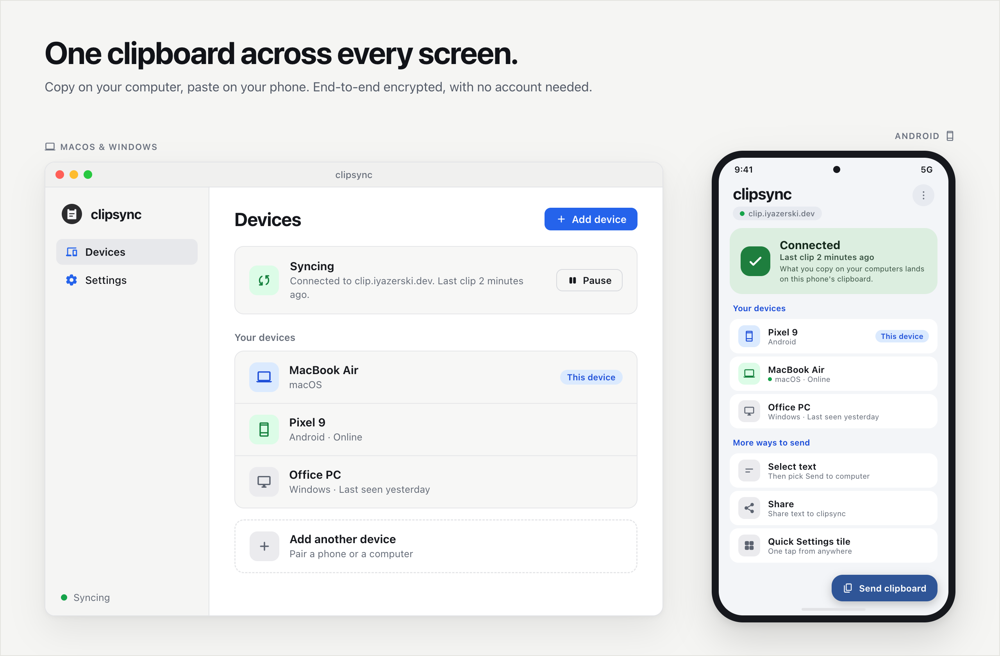

<div align="center">


# clipsync

**Copy on one device, paste on another.**

Sync your clipboard across Mac, Windows, and Android, over any network.<br>
Free, end-to-end encrypted, and no account needed.

[](https://github.com/iyazerski/clipsync/releases/latest)
[](#get-started)
[](LICENSE)
[](https://buymeacoffee.com/iyazerski)

<picture>
  <source media="(prefers-color-scheme: dark)" srcset="docs/assets/hero-dark.png">
  
</picture>

</div>

## Why clipsync

Universal Clipboard is Apple-only, Phone Link needs a Microsoft account, and KDE Connect needs the same Wi-Fi. clipsync works across Mac, Windows, and Android on any network.

- **Any network.** Works across home Wi-Fi, office networks, and mobile data.
- **Private by default.** End-to-end encrypted with AES-256-GCM. Password manager copies are skipped automatically.
- **No account.** No sign-up or tracking. Use the free public relay, or [host your own](docs/self-hosting.md).
- **Open source.** Free and MIT licensed.

## Get started

Works on **macOS 13+**, **Windows**, and **Android 14+**.

### 1. Install on your computers

Download the installer from the [website](https://iyazerski.github.io/clipsync/), or install from the command line:

**Mac** (Homebrew):

```sh
brew install --cask iyazerski/tap/clipsync
```

**Windows** (PowerShell):

```powershell
irm https://github.com/iyazerski/clipsync/releases/latest/download/install.ps1 | iex
```

The app isn't signed by Apple or Microsoft yet, so your computer warns you the first time:

- **Mac:** Open clipsync once, then go to **System Settings → Privacy & Security → Open Anyway**.
- **Windows:** Click **More info → Run anyway**. The PowerShell command skips this warning and verifies `SHA256SUMS`.

Every release is built by GitHub Actions ([verify a download](SECURITY.md#check-a-download)). Free Windows code signing from [SignPath Foundation](https://signpath.org) is in progress ([code signing policy](CODE_SIGNING.md)).

<details>
<summary><b>Windows Defender blocked the install?</b></summary>

New builds don't have Defender reputation yet. If **Use advanced protection against ransomware** is on, allow clipsync's folder in an administrator PowerShell, then install again:

```powershell
Add-MpPreference -AttackSurfaceReductionOnlyExclusions "$env:LOCALAPPDATA\Programs\clipsync"
```

On a work PC, ask IT to allow that folder.

</details>

### 2. Pair your devices

1. **First computer:** Open clipsync and click **Set up my first device**.
2. **Other computers:** Click **Add device → Computer** on the first computer. On the other, click **Join my other devices** and type the code.
3. **Android:** Click **Add device** on your computer and scan the QR code to download, then scan again to pair (or tap **Enter a code**).

Copy on one device, paste on another.

- **Mac:** Click **Allow** if macOS asks whether clipsync can paste.
- **Android:** Allow background activity when prompted (on OPPO/OnePlus ColorOS, also enable **Allow background activity** and **Allow auto launch** under App info → Battery usage). Copies from computers arrive automatically. To send from Android, tap the **Send clipboard** Quick Settings tile, share text to clipsync, or highlight text and pick **Send to computer**.

## FAQ

<details>
<summary><b>Is my clipboard private?</b></summary>

Yes. Your devices share a private key and encrypt every copy with AES-256-GCM before sending. The relay can't read it, keeps only the latest encrypted copy in memory for 2 minutes, and only sees connection times, IP addresses, and clip sizes.

</details>

<details>
<summary><b>Is it safe to install an unsigned app?</b></summary>

Every release is built from this repository by GitHub Actions. You can verify any download with the [GitHub CLI](https://cli.github.com):

```sh
gh attestation verify clipsync.apk --repo iyazerski/clipsync
```

See [SECURITY.md](SECURITY.md#check-a-download) for SHA-256 checksums and the Android signing certificate. Free Windows code signing from [SignPath Foundation](https://signpath.org) is in progress ([code signing policy](CODE_SIGNING.md)).

</details>

<details>
<summary><b>Does it sync images or files?</b></summary>

No. Text only, up to 256 KB. No history, and the latest copy wins.

</details>

<details>
<summary><b>What if a device was offline?</b></summary>

If it reconnects within 2 minutes, it gets the latest copy. After that, it starts fresh.

</details>

<details>
<summary><b>Does it work on iPhone or Linux?</b></summary>

Not yet. Currently macOS (Apple silicon and Intel), Windows, and Android.

</details>

<details>
<summary><b>How do I change settings or update?</b></summary>

Open **Settings** on desktop for language, launch at login, tray icon, logs, and auto-updates. On Android, open **⋮ → Check for updates**.

</details>

<details>
<summary><b>How do I remove a lost or old device?</b></summary>

On desktop, open **Devices**, click **⋯** next to the device, and pick **Remove…**. That creates a new pairing key, so re-add your other devices with the new code. (On a private relay with `CLIPSYNC_TOKEN`, update its token from **Settings** and restart it before clicking **New code**.) **Hide from list** only hides it on that computer.

</details>

<details>
<summary><b>How do I uninstall clipsync?</b></summary>

- **Mac:** **Settings → Unpair**, quit, and move to Trash (or `brew uninstall --cask clipsync`).
- **Windows:** **Settings → Unpair**, quit, and uninstall from **Settings → Apps**.
- **Android:** **⋮ → Unpair**, then uninstall.

</details>

## Host your own relay

By default, clipsync uses the free public relay at `clip.iyazerski.dev` (no uptime guarantee). To run your own with Docker, see the [self-hosting guide](docs/self-hosting.md).

## Build from source

Requires [Go](https://go.dev/dl/) 1.27.4+ (desktop built with [MyGo](https://mygo.run)) and, for Android, JDK 21 + Android SDK (`ANDROID_HOME`).

```sh
make dev                                  # run desktop app with reload
make app                                  # build desktop app into desktop/build
make test                                 # run Go and Android checks
cd android && ./gradlew assembleRelease   # build Android APK
```

See [CONTRIBUTING.md](.github/CONTRIBUTING.md) for details and pre-commit hooks (`prek install`).

## License

[MIT](LICENSE) © Ihar Yazerski. Third-party licenses in [THIRD_PARTY_LICENSES.md](THIRD_PARTY_LICENSES.md). Issues and PRs welcome ([CONTRIBUTING.md](.github/CONTRIBUTING.md)).

[Privacy policy](PRIVACY.md) · [Code signing policy](CODE_SIGNING.md) · [Security](SECURITY.md)

clipsync isn't affiliated with or endorsed by Apple, Microsoft, or Google. Mac, Windows, and Android are trademarks of their owners.
