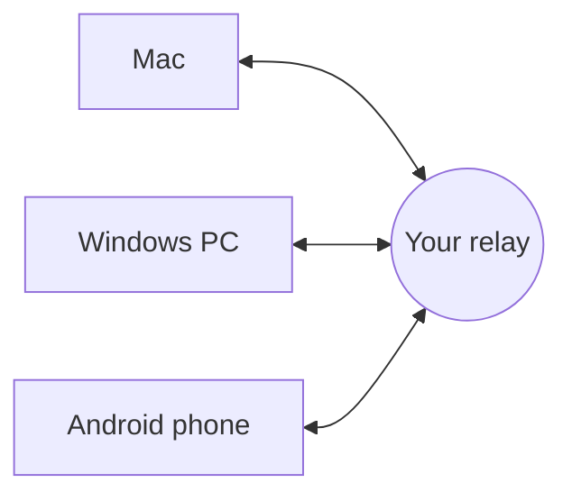

<div align="center">


# clipsync

**Copy on one device, paste on another.**

clipsync keeps the clipboards of your Macs, Windows PCs and Android phone in sync, over any network.<br>
It's end-to-end encrypted, and it runs through a tiny relay that you host yourself.

[](https://github.com/iyazerski/clipsync/releases/latest)
[](#get-started)
[](LICENSE)
[](https://go.dev)
[](https://buymeacoffee.com/iyazerski)

<picture>
  <source media="(prefers-color-scheme: dark)" srcset="docs/screenshots/phone-dark.png">
  
</picture>

</div>

## Why clipsync

Apple's Universal Clipboard works only between Apple devices that are close to each other. Windows syncs its clipboard only between Windows PCs. Most open-source tools for Android work only on your home Wi-Fi, and stop when the phone saves battery.

- **Mac, Windows and Android together.** Copy a link on your phone and paste it on your work PC. Copy an address on your Mac and paste it into your phone's maps app.
- **Works from anywhere.** Your devices don't need to be on the same Wi-Fi, or near each other. Home, office or mobile data, it keeps working when you switch.
- **Private by design.** Text is encrypted on the device before it leaves. The relay passes it on, but can't read it. It keeps only the latest copy, in memory, for 2 minutes.
- **Skips your passwords.** clipsync ignores copies that password managers mark as private.
- **Yours.** No account, no cloud service, no tracking. The relay runs in a small container and supports both x86-64 and ARM64 hosts.
- **Set up in minutes.** One command per computer. Pair the phone by scanning a QR code.
- **Free and open source.** MIT licensed.

## How it works



- **Relay:** a tiny server that you run. It passes each copy to your other devices. Nobody is the "host", so it doesn't matter which device is on or what its IP address is.
- **Computers:** a background service sends what you copy and puts what your other devices copy on the clipboard. It starts at login.
- **Phone:** the app puts what you copy on your computers on the phone's clipboard, automatically. Android doesn't let apps read the clipboard in the background, so sending from the phone takes one tap: select text and pick **Send to computers**, share text to clipsync, or tap the **Send clipboard** tile in Quick Settings.
- **Encryption:** your devices share one secret. Each copy is sealed with AES-256-GCM on the device. The relay only gets a token derived from the secret, so it can let your devices in, but it can't read what they send. Devices also refuse copies that are old or that they already got.

## Get started

You need:

- Macs with Apple silicon, Windows PCs, or both. An Android phone with Android 14 or later is optional.
- A server for the relay with Docker, ports 80 and 443 open, and a domain name pointing to it, like `clip.example.com`. A small cloud server or a home server works.

### 1. Set up your first computer

On a Mac, in Terminal, with [Homebrew](https://brew.sh):

```sh
brew install iyazerski/tap/clipsync
clipsync setup --relay https://clip.example.com
```

Or without Homebrew:

```sh
curl -fsSL https://raw.githubusercontent.com/iyazerski/clipsync/main/install.sh | sh
clipsync setup --relay https://clip.example.com
```

On Windows, in PowerShell:

```powershell
irm https://raw.githubusercontent.com/iyazerski/clipsync/main/install.ps1 | iex
clipsync setup --relay https://clip.example.com
```

If the installer asks you to open a new terminal or to add a folder to your PATH, do that first. Use your relay's address. `setup` makes a new secret and starts clipsync in the background. It says the relay isn't reachable yet. That's expected: you start the relay next. If macOS asks whether clipsync may access the pasteboard, choose to always allow it.

### 2. Start your relay

Print the token that the relay will accept:

```sh
clipsync token
```

On your server, download [`relay/compose.yaml`](relay/compose.yaml), and create a `.env` file next to it with your domain and that token:

```sh
curl -fsSLO https://raw.githubusercontent.com/iyazerski/clipsync/main/relay/compose.yaml
printf 'RELAY_DOMAIN=clip.example.com\nCLIPSYNC_TOKEN=<your token>\n' > .env
docker compose up -d
```

This starts the relay behind [Caddy](https://caddyserver.com), which gets a free HTTPS certificate for your domain and renews it. Within a minute, your computer connects by itself.

<details>
<summary><b>Already have a reverse proxy?</b></summary>

Run only the relay, and point your proxy at port 8080:

```sh
docker run -d --restart unless-stopped -p 127.0.0.1:8080:8080 \
  -e CLIPSYNC_TOKEN=<your token> ghcr.io/iyazerski/clipsync/relay
```

The proxy must serve HTTPS and pass streamed responses through as they come. Caddy and Traefik do that as they are. For nginx, turn off `proxy_buffering`. Cloudflare's quick tunnels (`trycloudflare.com`) don't work, because they buffer streams.

</details>

### 3. Add your other computers

On your first computer, run:

```sh
clipsync pair
```

It shows a `clipsync setup --relay … --secret …` command. Install clipsync on each other computer as in step 1, then run that command there.

### 4. Add your phone

1. [Download the app](https://github.com/iyazerski/clipsync/releases/latest/download/clipsync.apk) on the phone and install it. Android asks you to allow installing apps from your browser the first time.
2. Run `clipsync pair` on a computer, scan the QR code with the phone's camera, and tap **Open clipsync**.
3. In the app, tap **Allow** next to **Run in the background**, and **Add** next to **Quick Settings tile**. On ColorOS, also go to App info → Battery usage and turn on **Allow background activity** and **Allow auto launch**.

That's it. Copy something on one device and paste it on another.

### If Defender blocks clipsync

The Windows binaries aren't signed yet, so a new release has no reputation with Microsoft Defender. If the attack surface reduction rule **Use advanced protection against ransomware** is on, Defender blocks clipsync until enough people run that build. Allow clipsync's folder from an administrator PowerShell, then install again:

```powershell
Add-MpPreference -AttackSurfaceReductionOnlyExclusions "$env:LOCALAPPDATA\Programs\clipsync"
```

On a work PC, IT may manage this rule: ask them to allow that folder.

## Commands

| Command | What it does |
| --- | --- |
| `clipsync setup --relay <url>` | Link this computer to the relay and start syncing in the background. Add `--secret` to join devices you already set up. |
| `clipsync pair` | Show the QR code for your phone and the setup command for other computers. |
| `clipsync token` | Print the token for the relay's `CLIPSYNC_TOKEN`. |
| `clipsync update` | Install the latest version and restart the background service. With Homebrew, run `brew upgrade clipsync` instead. |
| `clipsync uninstall` | Stop syncing in the background. Your settings stay. |

The service logs to `~/Library/Logs/clipsync.log` on a Mac and to `%LOCALAPPDATA%\clipsync\clipsync.log` on Windows. The phone app updates itself from **Check for updates**.

## FAQ

<details>
<summary><b>Why do I need my own relay?</b></summary>

Your devices are often on different networks, behind routers that don't accept incoming connections. A relay that every device can reach solves that, without making any device the "host". Hosting it yourself means nobody else is in the middle, and nobody can turn it off or start charging for it. The relay never sees your text, but it's still your server.

</details>
<details>
<summary><b>What can the relay see?</b></summary>

It sees when your devices connect, their IP addresses, and the size of each copy. It can't read the text: that's sealed with a key that only your devices have. It keeps only the latest sealed copy, in memory, for 2 minutes. Without your token, it refuses to talk to a device.

</details>
<details>
<summary><b>Does it sync images or files?</b></summary>

No. Text only, up to 256 KB. The last copy wins, and there's no history.

</details>
<details>
<summary><b>What if a device was offline?</b></summary>

When it reconnects within 2 minutes, it gets the latest copy. After that, it doesn't get what was copied in the meantime, just like Universal Clipboard. A computer that just started or logged in doesn't get copies from before that.

</details>
<details>
<summary><b>Why does sending from the phone take a tap?</b></summary>

Since Android 10, apps can't read the clipboard in the background, so no app can send what you copy on the phone by itself. clipsync makes the tap as short as it can: **Send to computers** in the text selection menu, the share sheet, or the Quick Settings tile. Receiving on the phone needs no tap.

</details>
<details>
<summary><b>Does it work on iPhone, Linux or Intel Macs?</b></summary>

Not yet. The desktop service runs on Macs with Apple silicon and on Windows, and the phone app is for Android.

</details>
<details>
<summary><b>How do I remove it?</b></summary>

Run `clipsync uninstall`. Then run `brew uninstall clipsync`, or delete the binary (`~/.local/bin/clipsync` on a Mac, `%LOCALAPPDATA%\Programs\clipsync` on Windows) and the settings folder (`~/Library/Application Support/clipsync` on a Mac, `%LOCALAPPDATA%\clipsync` on Windows). On the phone, tap **Unpair** and uninstall the app.

</details>

## Build from source

The desktop service and relay need [Go](https://go.dev/dl/) 1.27.4 or later. Android needs JDK 21 and the Android SDK. Set `ANDROID_HOME` to the SDK directory.

```sh
make install   # build clipsync and put it in ~/.local/bin
make test      # run the Go and Android checks
cd android && ./gradlew assembleRelease   # build the app
```

Pre-commit hooks run with [prek](https://github.com/j178/prek): `prek install`. See [CONTRIBUTING.md](CONTRIBUTING.md) for more.

## License

[MIT](LICENSE) © Ihar Yazerski. clipsync includes open-source software under its own licenses: see [THIRD_PARTY_LICENSES.md](THIRD_PARTY_LICENSES.md). Issues and pull requests are welcome: see [CONTRIBUTING.md](CONTRIBUTING.md).

clipsync isn't affiliated with or endorsed by Apple, Microsoft or Google. Mac, Windows and Android are trademarks of their owners.
